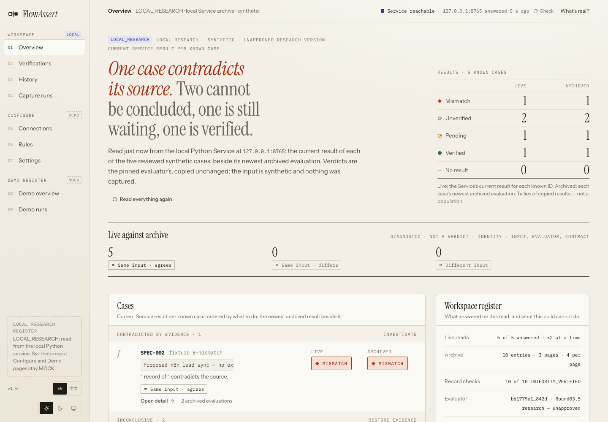
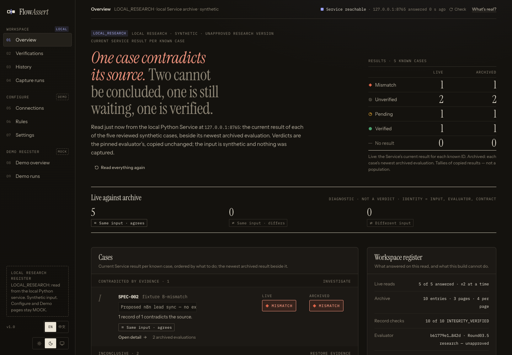
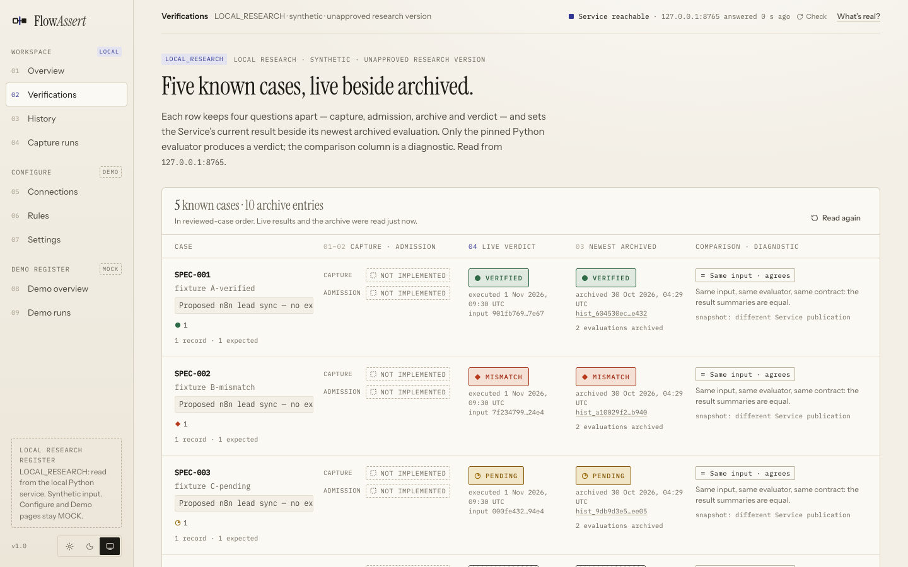
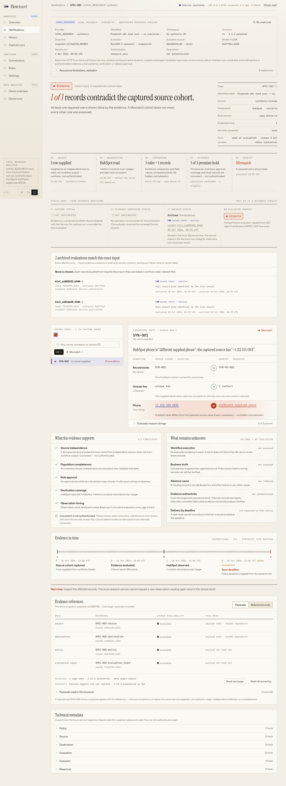
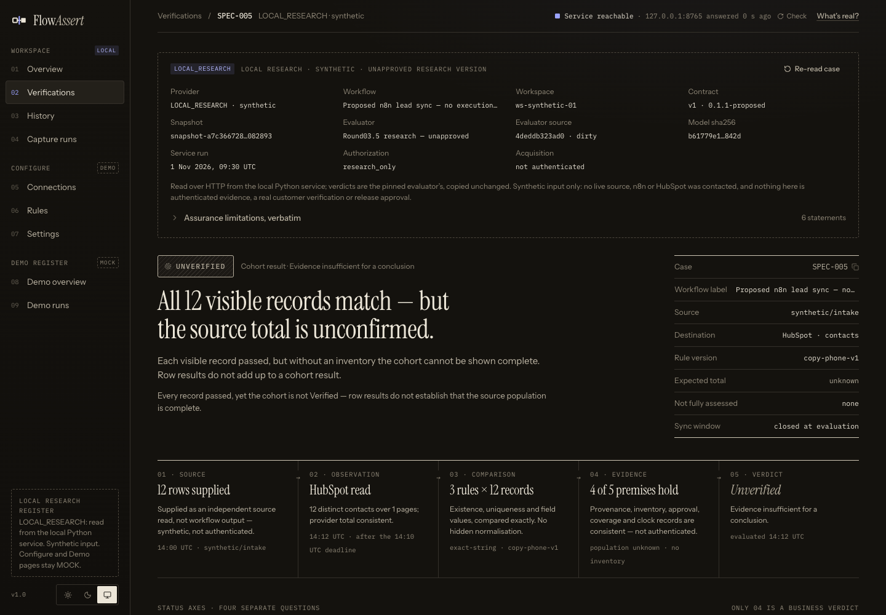
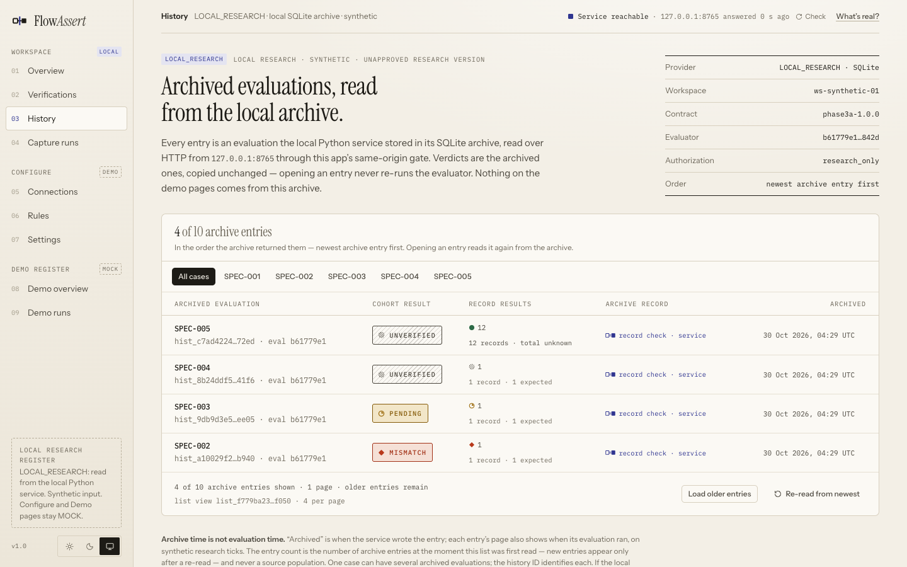
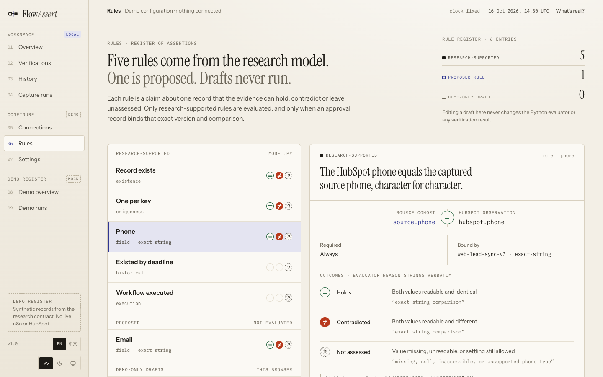
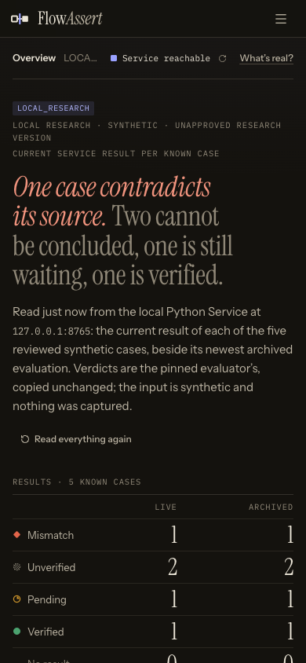

# FlowAssert

**The workflow succeeded. Did the expected business data actually arrive?**

FlowAssert compares what should exist with what a destination system holds, then reports each record as **Verified**, **Mismatch**, **Pending** or **Unverified**. Its central rule: without enough evidence, it refuses to say Verified.

> [!IMPORTANT]
> **Archived research prototype, closed on 2026-11-01.** It is not maintained and is not production software.
> The Service and UI work on five reviewed synthetic cases only. They have no live n8n, HubSpot or Google Sheets connection, take no credentials, and capture no external data. Hashes and local receipts show internal consistency, not that any data is authentic.

License: [Apache 2.0](LICENSE)



## Contents

- [The problem](#the-problem)
- [Screenshots](#screenshots)
- [What is and is not here](#what-is-and-is-not-here)
- [Quick start: compare two CSV files](#quick-start-compare-two-csv-files)
- [Quick start: run the Service and UI](#quick-start-run-the-service-and-ui)
- [How verification works](#how-verification-works)
- [Architecture](#architecture)
- [Backend](#backend)
- [Frontend](#frontend)
- [Testing](#testing)
- [Security model](#security-model)
- [Known issues](#known-issues)
- [Extending it](#extending-it)
- [Repository layout](#repository-layout)
- [Project history](#project-history)
- [Glossary](#glossary)
- [Contributing](#contributing)
- [License](#license)

## The problem

A successful automation run does not prove a correct business outcome. A workflow can write a wrong value, skip a lead, or create duplicates while reporting success.

Suppose a workflow should sync 100 leads. 97 match, 2 have wrong values, and 1 is missing after the allowed window. The honest report is 97 Verified and 3 Mismatch, not "100 succeeded". If the check cannot see enough of the destination, that record is Unverified, not missing.

The intended users were independent automation developers and small studios. That profile was never validated: no user interviews took place, and no real account was tested.

## Screenshots

Every screen below shows reviewed synthetic data from a local run. Dates and times are synthetic or local to that run.

### Overview

The opening page states the result in words, then shows live results beside the newest archived results for each case. "Live against archive" compares two Service outputs. It is a diagnostic, not a verdict.

| Light | Dark |
| --- | --- |
|  |  |

### Verifications

Each case on one page, with capture and admission kept apart from the live and archived verdicts. Both of those columns show *Not implemented* for the reviewed fixtures, on purpose.



### A Mismatch, from claim to evidence

`SPEC-002` read from top to bottom: the verdict, how it was reached, the four status axes, matching archive entries, the record comparison, what the evidence supports, what stays unknown, the timeline, and the evidence references the browser re-hashes.

<details>
<summary>Open the full page</summary>



</details>

### Every row passes, and the batch is still Unverified

`SPEC-005` is the case the product exists for. All 12 visible records match, but the source total is unknown, so FlowAssert does not call the batch Verified.



### History

Archived evaluations, newest first, each with its own integrity statement. Archive time and evaluation time are kept separate.



### Demo pages

Rules, Connections and Settings are mock pages, and they say so. A rule draft stays in the browser and never runs.



### Narrow screens

The workspace pages are checked across a 200-cell responsive matrix, in both themes.



## What is and is not here

| Area | State |
| --- | --- |
| Offline CSV check (`offline/`) | Works on your own local files |
| Pinned Evaluator with four result states | Works on the five synthetic cases |
| Read-only HTTP Service | Works locally |
| Append-only SQLite history archive | Works locally; only the reviewed cases can be archived |
| React UI for results, evidence and history | Works locally against the Service |
| Local execution receipts | Experimental; they prove nothing outside this Service |
| Connections, Rules, Settings pages | Mock demo. Nothing connects or runs |
| Capture runs page | Not implemented |
| n8n, HubSpot or Google Sheets connectors | Do not exist |
| Starting a verification from the UI | Does not exist |
| Login, multi-user, deployment | Do not exist |
| User validation | Never done |

## Quick start: compare two CSV files

This needs only Python 3.9 or later. It reads local files and makes no network requests.

```sh
git clone https://github.com/Sun-sh902/FlowAssert.git
cd FlowAssert

python3 offline/verify.py \
  --source offline/examples/source.csv \
  --destination offline/examples/destination.csv \
  --key external_id \
  --field phone \
  --field email:hs_email \
  --source-complete --destination-complete
```

The result, with exit status 1:

```text
Mismatch: 4 rows of 4
Verified 1 · Mismatch 3 · Unverified 0
  record 2 SYN-002: Mismatch
    field:phone fail: exact string comparison ('+1 212 555 0102' vs '+1 212 555 0199')
  record 3 SYN-003: Mismatch
    existence fail: key not found in stated complete destination
    ...
  record 4 SYN-004: Mismatch
    uniqueness fail: more than one destination row carries this key
    ...
```

`email:hs_email` means the column is `email` in the source and `hs_email` in the destination.

| Option | Meaning |
| --- | --- |
| `--key COL[:COL]` | Stable record key. Required |
| `--field COL[:COL]` | Field to compare. Repeatable; at least one is required |
| `--source-complete` | You state that the source file is the whole batch |
| `--destination-complete` | You state that the export covers the whole object |
| `--json PATH` | Write a full report with file digests. Refuses to overwrite a file |
| `--redact-values` | Leave keys and compared values out of the output |

| Exit status | Meaning |
| --- | --- |
| 0 | Verified |
| 1 | Mismatch |
| 3 | Unverified |
| 2 | Input refused, such as a malformed file or a missing column |
| 4 | Internal failure; nothing was concluded |

The two completeness flags matter. Without `--source-complete`, a batch cannot be Verified. Without `--destination-complete`, missing records and duplicates stay unknown. FlowAssert does not check these statements, so a wrong statement gives a wrong result.

Comparison is exact: spaces, case and phone formatting count as differences. Empty cells are Unverified, because a CSV cannot show why a value is empty. Full details are in [offline/README.md](offline/README.md).

## Quick start: run the Service and UI

### Requirements

| Tool | Version |
| --- | --- |
| Python | 3.14, for the Service |
| System Python 3 | `/usr/bin/python3`, for isolated read-only checks |
| Node.js | 22.12+ in the 22 line, 24, or 26+ |
| npm, git, lsof, curl | Any recent version |
| Google Chrome and Playwright WebKit | Browser test suites only |

It was developed and tested on macOS on Apple silicon. Other platforms are untested.

### Install

```sh
scripts/dev/bootstrap.sh
```

This installs exact dependencies from the lock files, verifies pinned file identities, and creates the synthetic archives. Each stage names its failure and log. If `python3.14` is not on your `PATH`, point to it:

```sh
FA_PYTHON=/path/to/python3.14 scripts/dev/bootstrap.sh
```

### Run

In one terminal:

```sh
scripts/dev/service.sh
```

In another:

```sh
cd ui
npm run dev
```

Open <http://127.0.0.1:5183>. Stop either process with Ctrl-C. With the Service stopped, the pages show *Service unavailable*, never demo data.

Choose a different archive with `FA_STATE`:

| State | Contents |
| --- | --- |
| `dev-main` (default) | 10 archived evaluations: 5 cases, 2 batches |
| `dev-single` | 5 archived evaluations, one per case |
| `dev-empty` | A valid empty archive |
| `dev-run-bound` | 6 archived evaluations; the newest `SPEC-001` has a local receipt |

```sh
FA_STATE=dev-run-bound scripts/dev/service.sh
```

### Pages

| Page | Address | Data |
| --- | --- | --- |
| Overview | `#/` | Service |
| Verifications | `#/verifications` | Service |
| Verification detail and evidence | `#/local/verifications/SPEC-001` | Service |
| Detail by exact ID | `#/local/verification-lookup?verification_id=SPEC-001` | Service |
| History | `#/local/history` | Service archive |
| Capture runs | `#/capture` | Not implemented |
| Connections, Rules, Settings | `#/connections`, `#/rules`, `#/settings` | Mock |
| Demo | `#/demo`, `#/demo/verifications` | Mock |
| Interface states | `#/states` | Simulated |

In the UI, **live** means the result computed from a fixture when the Service started. It is not a fresh observation of any external system.

## How verification works

### The four states

| State | Meaning | What to do |
| --- | --- | --- |
| Verified | Every required rule has enough evidence and passes | Inspect the evidence if needed |
| Mismatch | At least one required rule is demonstrably false | Investigate the discrepancy |
| Pending | No conclusion yet, within an explicit waiting window | Wait or observe again |
| Unverified | Evidence or configuration is not enough | Restore what is missing |

A record takes the first state that applies:

1. Any rule failed: **Mismatch**.
2. Every rule passed: **Verified**.
3. It may still resolve inside a valid window: **Pending**.
4. Otherwise: **Unverified**.

Pending is never success. Unverified is never a confirmed failure. A failed request is neither: it has no verdict at all.

### Record and batch results are separate

A batch can be less certain than its records. If every row verifies but the full source population is unknown, the batch is **Unverified**, because rows that were never listed cannot be ruled out. A batch with any Mismatch is a Mismatch.

### Rules

The pinned Evaluator (`service/vendor/model.py`) applies these rules:

| Rule | Passes when |
| --- | --- |
| `existence` | A reliable destination record carries the key |
| `uniqueness` | Exactly one record carries the key, with complete coverage |
| `phone` | The value is an exact string match |
| `existed_by_deadline` | Never: a current read cannot prove the past. Required unless policy explicitly turns it off |
| `workflow_execution` | Never: this approach holds no execution evidence. Required unless policy explicitly turns it off |

Every premise must be exactly true. A missing or malformed value never permits a conclusion. The premises cover source independence, inventory, rule approval, identity reliability, access, freshness, clock trust, pagination, and destination coverage.

The rules behave asymmetrically on purpose. One visible wrong value proves a Mismatch, even from a partial read. Proving that a record is absent or unique needs complete evidence.

| Change to a verified case | Result |
| --- | --- |
| Partial read, value equal | Unverified |
| Partial read, value differs | Mismatch |
| Absent after the deadline, complete coverage | Mismatch |
| Absent inside the window | Pending |
| Absent, but absence evidence unreliable | Unverified |
| Two records with the same key | Mismatch, and no record is picked to compare |
| Observation clock untrusted | Unverified |
| Rule not approved | Unverified |

### The five reviewed cases

| ID | Fixture | Rows | Batch result | Why |
| --- | --- | --- | --- | --- |
| `SPEC-001` | `A-verified` | 1 | Verified | All rules pass |
| `SPEC-002` | `B-mismatch` | 1 | Mismatch | Phone differs |
| `SPEC-003` | `C-pending` | 1 | Pending | Not yet visible, window open |
| `SPEC-004` | `D-unverified` | 1 | Unverified | Destination access denied |
| `SPEC-005` | `E-row-verified-cohort-unverified` | 12 | Unverified | 12 records Verified, source population unknown |

### What a Verified result claims

The narrow claim is: at the recorded observation, the destination evidence satisfies the configured rules for the declared source cohort.

It does not claim that n8n performed the write, that the source is true, that every real-world lead is listed, that semantic duplicates are absent, or that the destination stays correct afterward.

## Architecture

```text
Browser (React, hash routes)
   │  relative /api/v1/...  GET only
   ▼
Vite API gate (dev and preview only; exact route and query allowlist)
   │
   ▼
FastAPI Service on 127.0.0.1:8765
   ├─ Catalog: five results computed at startup, held in memory
   └─ ArchiveStore: append-only SQLite
          ▲ written only by local commands
archive_cli.py, seed_run_bound.py ──> pinned Evaluator

offline/verify.py + evaluator_v2.py   separate; local CSV files only
```

There is no write route over HTTP. A static UI build has no gate, so its Service pages show *Service unavailable*.

The two evaluators are separate. The Service and UI use the frozen Evaluator v1, whose digest is pinned. `offline/` uses Evaluator v2, which supports selected fields and has had no independent review. The tests check that the two agree on the cases they share.

## Backend

Python 3.14, FastAPI, Pydantic, jsonschema and SQLite. Source is in `service/`.

### Modules

| File | Role |
| --- | --- |
| `app/main.py` | Application, frozen Detail and Evidence routes, error envelope, boundary middleware |
| `app/service.py` | Catalog, startup evaluation, signed evidence pagination |
| `app/adapter.py` | Calls the pinned Evaluator and checks its input was not changed |
| `app/identity.py` | Canonical JSON, digests, and pinned source identity checks |
| `app/validation.py` | Frozen schema validation and cross-field invariants |
| `app/models.py` | Pydantic models generated from the frozen OpenAPI |
| `app/history_api.py` | History routes |
| `app/history_store.py` | SQLite archive, publication, integrity checks, admission |
| `app/history_security.py` | Private files, signing keys, history cursors |
| `app/verification_lookup.py` | Exact-ID query routes |
| `app/local_boundary.py` | Host and Origin checks |
| `app/execution_collector.py` | Experimental run in a separate process, with an HMAC receipt |
| `app/admission_models.py`, `app/admission_serialization.py` | Experimental status types and their public form |
| `archive_cli.py` | Local `init`, `seed` and `check` commands |
| `run_history.py` | Supported launcher, with all routes |
| `run.py` | Frozen Phase 1 launcher, with two routes |

### HTTP API

All routes are GET and are served only on loopback.

| Route | Purpose |
| --- | --- |
| `/api/v1/verifications/{id}` | One result. `?phase3b=true` adds capture and admission fields |
| `/api/v1/verifications/{id}/evidence` | Its evidence, paged |
| `/api/v1/verification-lookup?verification_id=` | The same Detail, with the ID as query data |
| `/api/v1/verification-evidence?verification_id=` | The same evidence, with the ID as query data |
| `/api/v1/history` | Archive list, frozen form |
| `/api/v1/history/{history_id}` | One archived evaluation, frozen form |
| `/api/v1/history/{history_id}/evidence` | Its archived evidence |
| `/api/v1/history/verifications` | Archive list with experimental status fields |
| `/api/v1/history/verifications/{history_id}` | Archived evaluation with those fields |
| `/api/v1/history/verifications/{history_id}/evidence` | Archived evidence; the UI gate does not forward this route |

Contracts are in [`service/contracts/`](service/contracts/). Errors use one envelope:

```json
{
  "error": {
    "code": "run_not_found",
    "message": "Offline request could not be completed.",
    "request_id": "…",
    "retryable": false,
    "details": []
  }
}
```

| Status | Meaning |
| --- | --- |
| 400 | Bad query, or forged or mismatched cursor |
| 403 | Host or Origin refused |
| 404 | Not found |
| 409 | Snapshot conflict or expired snapshot |
| 422 | Invalid parameter |
| 503 | Source identity, integrity, or archive failure |

### Snapshots and cursors

| Namespace | Example | Lifetime |
| --- | --- | --- |
| Catalog | `snapshot-…` | Changes on every Service start, because it includes execution times |
| History | `history-snapshot_…` | Permanent; derived from the archived content |
| History list | `list_…` | Fixes one list view at a high-water mark |

Cursors are HMAC-signed and bound to their query scope. A forged cursor returns 400. An authentic cursor whose snapshot has gone returns 409.

### Archive

`service/migrations/001.sql` defines `archive_meta`, `archives`, `records`, `evidence` and `seed_sets`.

- Triggers block changes to published content and any deletion.
- Publication moves from `BUILDING` to `PUBLISHED` in one transaction, and replays the Evaluator first.
- `history_id` is `hist_` plus the SHA-256 of the canonical candidate.
- Each read checks file safety, schema, content digests, and record and evidence relationships.
- A failed check returns 503 with an integrity outcome, never partial data.

An archive candidate must semantically equal a reviewed fixture, so nothing outside the five cases can be archived.

### Experimental receipts

`execution_collector.py` runs the Evaluator in a separate process and signs a receipt binding input, result, Evaluator digest, context, and the full candidate. Only `scripts/dev/seed_run_bound.py` calls it; no HTTP route does.

`CAPTURED_COMPLETE` and `ADMITTED_RUN_BOUND` mean only that these local checks passed. The key sits on the same host, so a receipt cannot prove external capture. Live reads always report *Not implemented*. See [EXPERIMENTAL_ADMISSION_BOUNDARY.md](service/docs/phase3b/EXPERIMENTAL_ADMISSION_BOUNDARY.md).

## Frontend

React 19, TypeScript, Vite and Tailwind, in `ui/`. The design system is called Evidence Atelier ([DESIGN_SYSTEM.md](ui/docs/DESIGN_SYSTEM.md)).

The frontend never calculates a verdict. It receives, validates, and displays what the Service reports.

### Data flow

```text
exchange       GET only, no credentials, no redirects, time and size limits
  ▼
decode         frozen schema, then cross-field checks; refuse the whole body on any failure
  ▼
adapter        wire data to view models
  ▼
hook           request order, cancellation, snapshot pinning
  ▼
page
```

| Path | Role |
| --- | --- |
| `ui/server/localApiGate.ts` | Dev and preview API allowlist |
| `ui/src/data/local/` | Service provider, decoding, canonical JSON, ID rules, evidence chain |
| `ui/src/data/history/` | Archive provider, decoding, list chain |
| `ui/src/data/workspace/` | Live and archived comparison |
| `ui/src/data/contract/` | Wire types and exact schema copies |
| `ui/src/domain/` | View models, status axes, integrity rules |
| `ui/src/adapters/` | Wire data to view models |
| `ui/src/lib/` | Router, read lifecycle hooks, formatting |
| `ui/src/pages/`, `ui/src/components/` | Interface |
| `ui/src/mocks/` | Demo fixtures |
| `ui/src/lab/` | Design experiments, outside the product build |

### Separate vocabularies

These are kept apart so that one kind of problem is never reported as another.

| Vocabulary | Values | Question |
| --- | --- | --- |
| Verdict | 4 states | What is the business result? |
| Access state | 8 states, such as `LOADING` and `SERVICE_UNAVAILABLE` | How did this read go? |
| Integrity | `verified`, `failed`, `unverifiable`, `pending` | Does content match its digests? |
| Status axes | Capture, Admission, Archive, Verdict | What happened at each step? |
| Comparison | 8 states, such as `SAME_INPUT_AGREE` | How does live relate to archived? |

So a stopped Service shows `NO_VERDICT`, not Unverified. A difference between live and archived results is a diagnostic, not a Mismatch.

### Integrity and read behavior

- Evidence pages must concatenate to exactly the references the Detail lists. Duplicates, gaps, reordering and cursor cycles are refused.
- The browser rebuilds Python's canonical JSON from a lossless parse and recomputes SHA-256. If it cannot reproduce the bytes, the result is `not_checkable`, never a pass.
- Monotonic clock readings stay as decimal text, because they can exceed JavaScript's safe integers.
- There is no polling, caching, or automatic retry. Live reads run at most two at a time, and late answers are dropped.

A matching digest shows that two values from the same Service agree. It proves nothing about origin.

## Testing

| Layer | Tool | Scope |
| --- | --- | --- |
| Backend | pytest | Over 300 tests on routes, archive, cursors, receipts, failure paths |
| Scripts and offline check | pytest | Dev tooling, CSV check, agreement with Evaluator v1 |
| Frontend | Vitest | About 1,800 tests, including contract drift and hostile responses |
| Browser | Playwright | Chrome and WebKit suites for workspace, history, lookup, gate security, accessibility |
| Layout | Custom | 200-cell responsive matrix and layout-shift checks |
| Identity | `check_identities.py` | Pinned Evaluator, contracts, and backend source map |

Run a profile:

```sh
scripts/dev/regression.sh --portable NEW-LABEL   # backend, identities, typecheck, lint, Vitest
scripts/dev/regression.sh --product NEW-LABEL    # plus every browser suite and the matrix
scripts/dev/regression.sh NEW-LABEL              # release: plus historical custody
```

The browser profiles first need:

```sh
scripts/dev/bootstrap.sh --product-harness
cd ui && npx playwright install webkit
```

Gate status is PASS, FAIL, BLOCKED or NOT RUN. A run with a BLOCKED gate exits 3 and is not a pass. Test counts are checked against `scripts/dev/test-inventory.json`, so a skipped or missing test fails the run. Results go to `.dev-runtime/regression/LABEL/`.

**In your clone**, the `protected-custody` gate reports BLOCKED because it compares sibling folders from the original machine. Those folders are not published. Use `--product` for the fullest check that works elsewhere.

## Security model

The Service is built for a single user on a local machine.

| Control | What it does | What it does not do |
| --- | --- | --- |
| Loopback binding, Host and Origin checks | Limit browser DNS rebinding | Authenticate other local processes |
| API gate | Forwards exact GET routes only | Exist in a static build or production |
| Signed cursors | Stop forged pagination | Protect against someone holding the key |
| Pinned digests | Detect ordinary source changes | Stop someone who can edit code and pins |
| SQLite triggers and seals | Detect accidental change | Stop someone who can write the database; seals are unkeyed |
| Offline guard | Audits socket connections in Python | Provide operating-system isolation |

Do not expose the Service to a network or feed it real customer data. It has no authentication.

Repository history was scanned for common key formats before publication, and none were found. That is a pattern scan, not a security audit. Treat this code as unaudited.

## Known issues

| Issue | Detail |
| --- | --- |
| Evaluator status | The pinned version is labelled `Round03.5 research — unapproved` |
| P3A-AUD-001 | A legacy path such as `/api/v1/verifications/x%2Fevidence` can address the wrong resource. Use the query routes for unusual IDs |
| Archive seals | Unkeyed hashes. Anyone who can write the database can forge a consistent row |
| Browser test | One `e2e-lookup` failure on 2026-10-31 was never explained. It did not recur |
| Firefox | Not tested. A known harness defect is unfixed |
| Accessibility | Automated checks only; no screen-reader testing |
| Load | No load testing |
| `certifi 2026.7.22` | Affected by advisory GHSA-6q48-6c7w-9gw2. It is pulled in through `httpx`; the Service makes no outbound HTTPS requests. The pinned lock was left unchanged |
| `/docs` | FastAPI's docs page is enabled and loads assets from a CDN if opened |
| Old harness scripts | Some scripts in `ui/scripts/phase2` and `ui/scripts/phase3a` contain paths from the original machine |

`npm audit` reported no known vulnerabilities on 2026-11-01. An OSV lookup of the Python lock file reported only the `certifi` item.

## Extending it

The Service was built to fail on anything unreviewed, so several limits are deliberate and hardcoded:

| Limit | Location |
| --- | --- |
| Only `phone`, only exact comparison | `service/vendor/model.py`, `app/models.py`, contracts |
| Five cases, `SPEC-00[1-5]` | `app/history_api.py`, `app/history_store.py`, `ui/src/data/local/config.ts` |
| One workspace, `ws-synthetic-01` | `app/validation.py`, UI scope checks |
| Synthetic provenance only | `app/validation.py`, history contract |
| Archive must equal a reviewed fixture | `validate_candidate` in `app/history_store.py` |
| Pinned Evaluator identity | `app/identity.py`, `ui/src/data/local/config.ts` |

Changing `model.py` makes the Service return 503 until the pins are updated, which is intended.

The planned route to real data is in [docs/product-dev/final-version/](docs/product-dev/final-version/): [product definition v0.2](docs/product-dev/final-version/PRODUCT_DEFINITION_v0.2.md) and the [validation plan](docs/product-dev/final-version/S1_VALIDATION_PLAN.md). It recommends testing with users and read-only sandbox accounts before writing connectors. `offline/evaluator_v2.py` is the first step toward configurable rules.

## Repository layout

```text
offline/                     CSV check and Evaluator v2
service/
  app/                       FastAPI application
  vendor/model.py            Pinned Evaluator v1
  contracts/                 OpenAPI contracts and reviewed examples
  fixtures/                  Five synthetic cases
  migrations/                SQLite schema
  tests/                     Backend tests
  baseline/                  Accepted Phase 1 bytes, used by tests
  evidence/                  File-identity baselines
  docs/                      Backend design records
ui/
  src/                       Application
  server/                    Dev API gate
  e2e*/                      Browser tests
  scripts/                   Harness and evidence tools
  docs/                      Design and integration notes
scripts/dev/                 Bootstrap, seed, run, regression
docs/readme/                 Screenshots used by this README
docs/product-dev/            Reports, screenshots, raw test evidence
```

Most of `docs/product-dev/` and `service/evidence/` is the project's raw development record, published unchanged. Paths in it name the original machine and do not exist elsewhere. Rewriting them would break recorded digests.

Useful starting points:

| Topic | Document |
| --- | --- |
| Project closure | [PROJECT_CLOSEOUT_20261101.md](docs/product-dev/final-version/PROJECT_CLOSEOUT_20261101.md) |
| Archive design | [ARCHIVE_INTEGRITY_MODEL.md](service/docs/phase3a/ARCHIVE_INTEGRITY_MODEL.md), [SQLITE_SCHEMA.md](service/docs/phase3a/SQLITE_SCHEMA.md) |
| Snapshots and cursors | [SNAPSHOT_AND_CURSOR_MODEL.md](service/docs/phase3a/SNAPSHOT_AND_CURSOR_MODEL.md) |
| Backend decisions | [ARCHITECTURE_DECISIONS.md](service/docs/phase3a/ARCHITECTURE_DECISIONS.md) |
| Frontend contract | [frontend-provider-contract.md](service/contracts/frontend-provider-contract.md) |
| UI structure | [INFORMATION_ARCHITECTURE.md](ui/docs/INFORMATION_ARCHITECTURE.md) |
| Regression profiles | [REGRESSION_PROFILES.md](docs/product-dev/round-02-residual-closeout/REGRESSION_PROFILES.md) |

## Project history

| Date (2026) | Milestone |
| --- | --- |
| Oct 13 | Product definition, feasibility study, trust-model experiments |
| Oct 16–17 | Evidence Atelier UI, integration planning, first Service |
| Oct 20 | Phase 3A accepted by the Owner, for local synthetic research only, with one legacy exception |
| Oct 22–23 | Phase 3B planning accepted, without authorizing implementation; product rounds 1 and 2 |
| Oct 24–27 | Trusted Runner preparation; installation stopped at administrator sign-in |
| Oct 29 | Machine rebuilt; 452,602 files restored from an external drive |
| Oct 31 | Experimental local receipts and record reconciliation |
| Nov 1 | Final direction, offline CSV check, project closed |

Much of the development and review used AI coding assistants under one Owner. In these records, "independent review" means a separate role or session as far as the records show. It does not mean a third-party audit.

The Phase 3B work on this branch has no Owner acceptance and no independent review. Separate preparation materials for hardened capture were kept privately and are not in this repository.

## Glossary

| Term | Meaning |
| --- | --- |
| Owner | The person making product and acceptance decisions |
| Evaluator | The code that produces verdicts |
| Cohort | The batch of source records being checked |
| Source population | Everything that should be in the cohort |
| Snapshot | A fixed identity for a set of results |
| Run-bound | Tied to one local execution by a receipt |
| Custody | Evidence that protected files have not changed |
| Phase 3A, 3B | Local archive stage; planned evidence-capture stage |
| G1 | An implementation grant that was never issued |
| M1 | The Trusted Runner milestone, which remained blocked |
| R1–R3 | Recovery stages after the machine rebuild |

## Contributing

This repository is archived, and issues and pull requests may go unanswered. You are welcome to fork it under the license.

## License

Copyright 2026 The FlowAssert Authors. Licensed under the [Apache License, Version 2.0](LICENSE). See [NOTICE](NOTICE).

HubSpot, n8n and Google Sheets are trademarks of their respective owners. This project is not affiliated with or endorsed by them.
