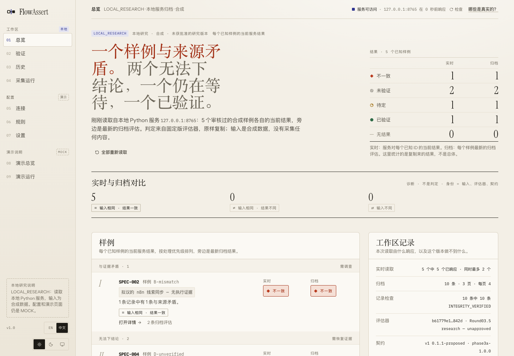
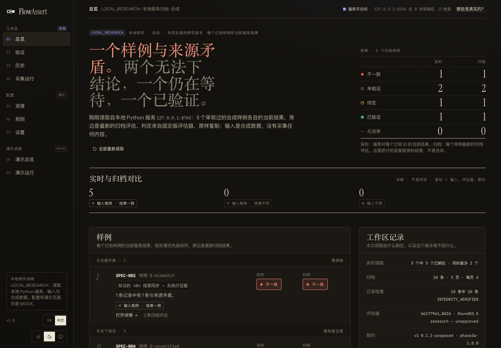
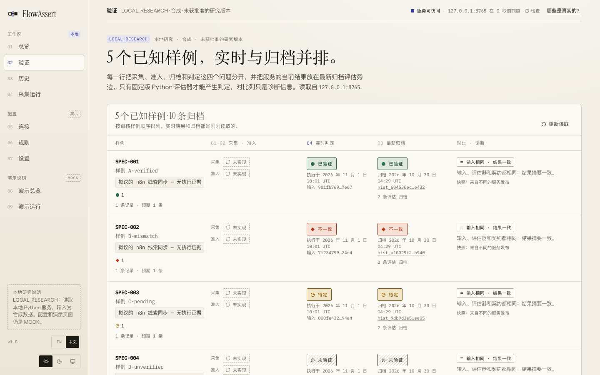
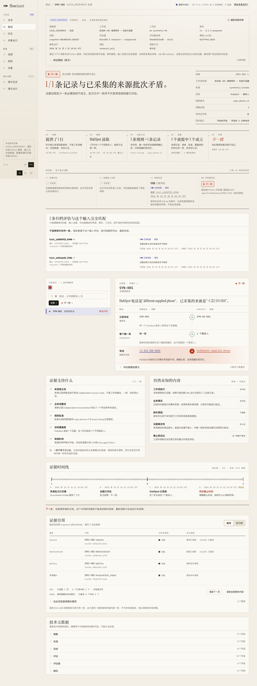
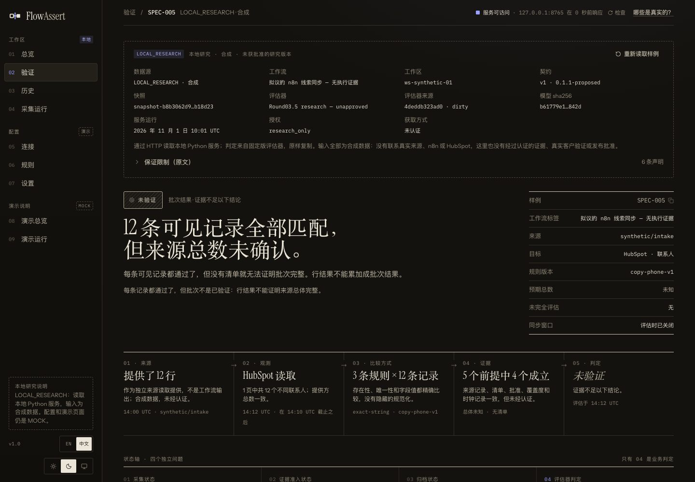
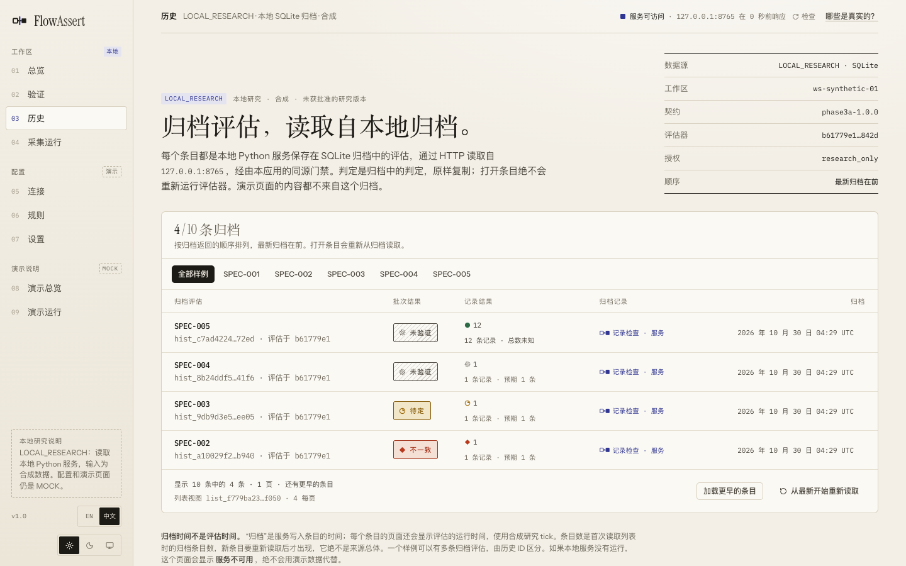
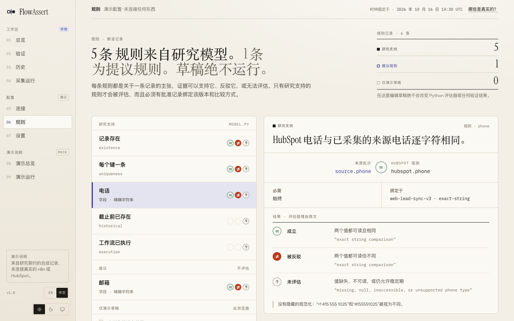
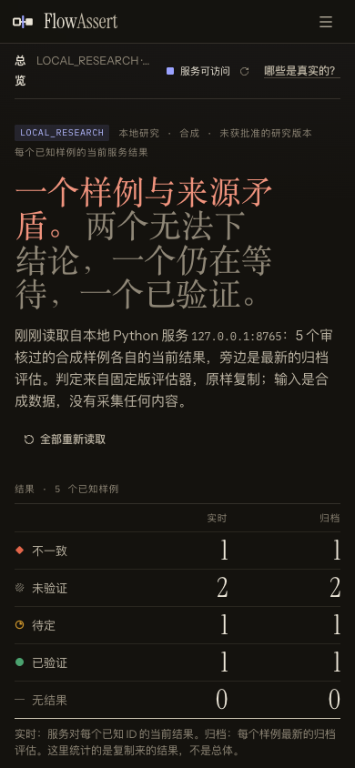

# FlowAssert

[English](README.md) | 简体中文

**工作流显示成功了，但预期的业务数据真的到了吗？**

FlowAssert 把来源 CSV（应该到达的记录）与目标系统的导出文件（现在实际有的记录）对照，把每条记录判定为 **Verified**、**Mismatch** 或 **Unverified**。它的核心规则是：证据不足时，绝不说 Verified。它在你的电脑上运行，可以用命令行，也可以用浏览器，只读取本地文件。

> [!IMPORTANT]
> **这是由一位维护者维护的早期项目。** 它还不是生产软件。
> Service 和 UI 只处理 5 个审核过的合成样例。它们没有连接真实的 n8n、HubSpot 或 Google Sheets，不接收凭据，也不采集外部数据。哈希和本地回执只能说明内部一致，不能证明任何数据是真实的。

## 在线试用

<https://sun-sh902.github.io/FlowAssert/> 在浏览器里运行核对。你的文件不会离开电脑：页面不发任何网络请求。

1. 选择你的两个 CSV 文件，或在 **手边没有文件？试试一个场景** 中选一个合成场景（共四个）。
2. 选择键列和要比较的字段，只声明你确实知道的关于文件的内容。
3. 点 **检查**。结果下面的 **这个结果是什么意思** 只根据报告来解释结果。

详见[在浏览器中核对](#在浏览器中核对)。

## 安装并运行一次核对

只需要 Python 3.9 或更高版本。它只读取本地文件，不发任何网络请求。

```sh
git clone https://github.com/Sun-sh902/FlowAssert.git
cd FlowAssert
python3 -m pip install ./offline

flowassert-verify \
  --source offline/examples/source.csv \
  --destination offline/examples/destination.csv \
  --key external_id \
  --field phone \
  --field email:hs_email \
  --source-complete --destination-complete
```

结果如下，退出码为 1:

```text
Mismatch: 4 rows of 4
Verified 1 · Mismatch 3 · Unverified 0
  record 2 SYN-002: Mismatch
    field:phone fail: exact string comparison ('+1 212 555 0102' vs '+1 212 555 0199')
  record 3 SYN-003: Mismatch
    existence fail: key not found in stated complete destination
    ...
  record 4 SYN-004: Mismatch
    uniqueness fail: more than one destination row carries this key
    ...
```

[第一次核对指南](docs/guides/first-check.zh-CN.md)逐行解释输出，[第一次核对的场景](offline/examples/scenarios/README.zh-CN.md)里有更多可以运行的小例子。核对被拒绝（退出码 2）时，[核对被拒绝时](docs/guides/refusals.zh-CN.md)解释每条消息。

## 四种结果的意思

| 结果 | 意思 | 退出码 | 该做什么 |
| --- | --- | --- | --- |
| **Verified**（已验证） | 在你声明的前提下，每条记录都通过了每条规则，并且这一批已知是完整的 | 0 | 保留报告；前提是结果的一部分 |
| **Mismatch**（不一致） | 至少一条规则被证明不成立：某个值不同、某条记录不在已声明完整的导出中，或两行目标数据带有同一个键 | 1 | 查看列出的记录 |
| **Unverified**（未验证） | 没有规则被证明不成立，但证据不足以说 Verified | 3 | 看哪些内容没有确立，以及什么证据能解决 |
| **Pending**（待定） | 在等待窗口内，暂时没有结论。CSV 核对没有等待窗口，所以从不给出 Pending | — | 等待或重新观测 |

输入被拒绝（退出码 2）或内部故障（4）都没有结果。批次可能比记录更不确定：每条记录都通过，但没有声明来源文件是完整的一批时，批次是 Unverified。FlowAssert 不检查你的声明，所以声明错了，结果也会错。[为什么我的结果是 Unverified？](docs/faq.zh-CN.md#为什么我的结果是-unverified)

**试用过了？告诉我们：** [试用反馈表单](https://github.com/Sun-sh902/FlowAssert/issues/new?template=trial_feedback_zh-CN.yml)会问你是怎么用的、想核对什么、卡在哪里、结果是否清楚。表单内容是公开的，请不要粘贴真实数据、键、值或报告。

界面支持简体中文：在左侧栏底部切换 `EN` 和 `中文` 即可。本文的截图来自中文界面。

| 英文 | 中文界面 |
| --- | --- |
| Verified | 已验证 |
| Mismatch | 不一致 |
| Pending | 待定 |
| Unverified | 未验证 |

下文保留这四个英文术语，以及接口和代码中的英文名称，方便与代码对照。如有出入，以[英文版](README.md)为准。

## 目录

- [在线试用](#在线试用)
- [安装并运行一次核对](#安装并运行一次核对)
- [四种结果的意思](#四种结果的意思)
- [要解决的问题](#要解决的问题)
- [截图](#截图)
- [已有和没有的内容](#已有和没有的内容)
- [命令行选项](#命令行选项)
- [在浏览器中核对](#在浏览器中核对)
- [在 GitHub Actions 中使用](#在-github-actions-中使用)
- [在 n8n 中使用](#在-n8n-中使用)
- [验证如何工作](#验证如何工作)
- [安全模型](#安全模型)
- [已知问题](#已知问题)
- [常见问题](#常见问题)
- [开发](#开发)
- [术语表](#术语表)
- [路线图](#路线图)
- [参与贡献](#参与贡献)
- [许可证](#许可证)

## 要解决的问题

自动化运行成功，不代表业务结果正确。工作流可能写错值、漏掉线索或创建重复记录，却依然显示成功。

假设一个工作流要同步 100 条线索：97 条匹配，2 条的值错误，1 条在允许的时间窗口之后仍然缺失。如实的报告应该是 97 条 Verified、3 条 Mismatch，而不是“100 条成功”。如果检查看不到足够多的目标数据，那条记录应该是 Unverified，而不是缺失。

预期用户是独立自动化开发者和小型工作室。这个用户画像从未得到验证：没有做过用户访谈，也没有测试过真实账号。

## 截图

下面的页面都来自本地运行，显示的是审核过的合成数据。日期和时间要么是合成的，要么是那次本地运行的时间。

### 总览

首页先用文字说明结果，再把每个样例的实时结果和最新归档结果并排显示。“实时与归档对比”比较的是 Service 的两次输出，它是诊断信息，不是判定。

| 浅色 | 深色 |
| --- | --- |
|  |  |

### 验证

所有样例集中在一页，采集和准入与实时判定、归档判定分开显示。对审核样例来说，这两列都显示“未实现”，这是有意为之。



### 一次 Mismatch：从结论到证据

`SPEC-002` 的页面从上到下依次是：判定、判定过程、四个状态轴、匹配的归档条目、记录比较、证据支持的内容、仍然未知的内容、时间线，以及浏览器重新计算哈希的证据引用。

<details>
<summary>展开完整页面</summary>



</details>

### 每行都通过，批次仍是 Unverified

`SPEC-005` 正是这个产品存在的理由。12 条可见记录全部匹配，但来源总量未知，所以 FlowAssert 不会把这个批次判定为 Verified。



### 历史

归档的评估按从新到旧排列，每条都有自己的完整性声明。归档时间和评估时间分开记录。



### 演示页面

规则、连接和设置都是 Mock 页面，页面上也写明了这一点。规则草稿只留在浏览器里，不会执行。



### 窄屏

工作区页面用 200 格响应式矩阵检查过，覆盖两种主题。



## 已有和没有的内容

| 部分 | 状态 |
| --- | --- |
| 离线 CSV 核对(`offline/`) | 可用于你自己的本地文件 |
| 浏览器中的 CSV 核对(`ui/`、`#/check`) | 可用于你自己的本地文件，不上传任何内容 |
| GitHub Action(`action.yml`) | 在工作流中对文件运行离线核对，不安装也不下载任何东西 |
| n8n 示例(`examples/n8n/`) | 在 Code 节点中运行浏览器核对，只在自托管的 n8n 上测试过 |
| 带四种结果状态的固定版 Evaluator | 可用于 5 个合成样例 |
| 只读 HTTP Service | 可在本地运行 |
| 只增不改的 SQLite 历史归档 | 可在本地运行，只能归档审核过的样例 |
| 查看结果、证据和历史的 React UI | 可连接本地 Service 运行 |
| 本地执行回执 | 实验性质，在这个 Service 之外不能证明任何事 |
| Connections、Rules、Settings 页面 | Mock 演示，不连接也不执行任何东西 |
| Capture runs 页面 | 未实现 |
| n8n、HubSpot 或 Google Sheets 连接器 | 不存在 |
| 从 UI 发起验证 | 不存在 |
| 登录、多用户、部署 | 不存在 |
| 用户验证 | 从未做过 |

## 命令行选项

不安装也可以运行：把命令换成 `python3 offline/verify.py`，选项相同。也可以直接从 GitHub 安装：

```sh
python3 -m pip install "git+https://github.com/Sun-sh902/FlowAssert.git#subdirectory=offline"
```

`email:hs_email` 表示这一列在来源文件里叫 `email`，在目标文件里叫 `hs_email`。

| 选项 | 含义 |
| --- | --- |
| `--key COL[:COL]` | 稳定的记录键，未使用 `--mapping` 或 `--config` 时必填 |
| `--field COL[:COL]` | 要精确比较的字段，可重复，未使用 `--mapping` 或 `--config` 时至少一个 |
| `--mapping FILE` | 指定 `key` 和 `fields` 列名对的 UTF-8 JSON 文件，支持含 `:` 的列名，始终精确比较 |
| `--config FILE` | 指定 `key`、带比较规则的 `fields` 和 `scope` 的 UTF-8 JSON 配置文件，不能与 `--mapping`、`--key`、`--field`、`--scope` 同时使用 |
| `--scope source\|exact` | `source`（默认）：逐条检查来源记录。`exact`：同时列出目标中有、来源中没有的键 |
| `--source-complete` | 你声明来源文件就是整个批次 |
| `--destination-complete` | 你声明导出文件覆盖了整个对象 |
| `--source-count N` | 你声明在原系统里看到的来源总数；与文件行数不符时不能得到 Verified |
| `--destination-count N` | 你声明在原系统里看到的目标总数；与文件行数不符时缺失和重复都只能是未知 |
| `--allow-identical-content` | 两份不同文件的内容完全相同时允许继续，并在报告 `inputs` 中记录 |
| `--source-encoding NAME` | `utf-8`（默认）、`utf-16` 或 `gb18030` |
| `--destination-encoding NAME` | `utf-8`（默认）、`utf-16` 或 `gb18030` |
| `--max-bytes N` | 读取前拒绝超过 `N` 字节的文件（默认 `209715200`，即 200 MiB） |
| `--max-rows N` | 读取时拒绝超过 `N` 行的 CSV 文件（默认 `1000000`） |
| `--max-details N` | 摘要中最多打印 `N` 条非 Verified 记录，`0` 表示不打印（默认 `50`） |
| `--json PATH` | 写入含文件摘要的完整报告，不会覆盖已有文件。[格式说明（英文）](docs/report-format.md) |
| `--details problems\|all` | `problems`（默认）：`--json` 中 Verified 记录只保留键、行号和状态。`all`：保留每条记录的全部明细 |
| `--html PATH` | 写入一个独立的 HTML 报告，不会覆盖已有文件 |
| `--redact-values` | 输出中不显示键和比较值 |
| `--version` | 显示版本 |

| 退出码 | 含义 |
| --- | --- |
| 0 | Verified |
| 1 | Mismatch |
| 3 | Unverified |
| 2 | 输入被拒绝，例如文件格式错误或缺少列 |
| 4 | 内部故障，没有得出任何结论 |

核对被拒绝时，会用一行说明问题。[核对被拒绝时](docs/guides/refusals.zh-CN.md)逐条解释每条消息和处理方法。

这两个完整性选项很重要。不加 `--source-complete`，批次不可能是 Verified。不加 `--destination-complete`，缺失和重复都只能是未知。FlowAssert 不会核实这些声明，所以声明错了，结果也会错。如果知道原系统里的总数，再加上 `--source-count` 和 `--destination-count`：总数与文件不符时，对应的完整性声明不再成立。总数相符也不能证明文件完整。

默认是精确比较：空格、大小写和电话格式的差异都算不同。`--config` 配置文件可以为每个字段选择 `trim`、`casefold`、`digits` 或 `date:FORMAT`，规则不会自动推断。空单元格判为 Unverified，因为 CSV 无法说明它为什么是空的。详情见 [offline/README.md](offline/README.md)。

## 在浏览器中核对

同样的核对也可以在网页界面里完成，不用命令行：打开 **CSV 核对** 页面，选择两个文件、键列、要比较的字段和每个字段的规则，声明你知道的前提，然后点“检查”。结果、摘要以及 JSON 和 HTML 报告都与命令行逐字节相同，只是每项前提的来源记为 `browser form`（浏览器表单）。

**文件留在你的电脑上。** 文件在浏览器里（一个 Web Worker 中）读取，不上传任何内容：从选择文件到下载报告，页面不发出任何网络请求。你的选择和声明都不会被保存，每次核对都要重新选择文件、重新声明前提。只有列和规则的选择可以保存为一个由你自己下载的配置文件。只有在你要求时，报告才会保存在浏览器中（见下文）。

- **在线演示：** <https://sun-sh902.github.io/FlowAssert/>。它的内容安全策略（CSP）禁止任何连接；需要本地 Service 的页面会写明“仅本地可用”。
- **本地运行：** `cd ui && npm ci && npm run dev`，然后打开 <http://127.0.0.1:5183/#/check>。页面上有示例文件。

与命令行的区别：

| | 浏览器 | 命令行 |
| --- | --- | --- |
| 日期格式 | 只支持 `%Y %m %d %H %M %S %f %z %b %B %y %p %I %j %%`，其他指令会被拒绝，并说明浏览器不支持 | 支持所有 `strptime` 指令 |
| Python 版本差异 | 按 Python 3.15：`%d` 必须配合年份指令，值中可以没有 `%z` | 取决于运行它的 Python |
| 列的选择 | 总是使用配置：报告记录 `config_file_sha256`、`obligation.rules`、`obligation.scope` 和两个编码 | `--key`/`--field`、`--mapping` 或 `--config` |
| 选项 | 默认上限（200 MiB、1,000,000 行）、`--details problems`、不隐去值 | 所有选项 |
| 两次选择同一个文件 | 两个选择的文件名、大小、修改时间和字节都相同时拒绝；浏览器不提供文件路径 | 路径指向同一文件时拒绝 |
| 内存 | 读取时整个文件留在内存中 | 来源只保留用到的列，目标逐行读取 |

浏览器核对按同一份规范实现，并与命令行对照测试：全部一致性样例、97 个逐字节比较的黄金样例，以及随机样例（10,000 个中 0 处差异）。它是第二个实现，出现差异就是缺陷，欢迎报告。

### 已保存的报告和两次结果对比

从 0.5.0 开始，**已保存的报告**页面（`#/check/reports`）可以把 JSON 报告保存在这个浏览器中，并比较其中两份。

- **保存什么，只在你要求时保存。** 核对之后，点“在这个浏览器中保存这份报告”会保存这一份 JSON 报告。也可以导入命令行、GitHub Action 或 n8n 写出的 JSON 报告；不是有效 FlowAssert 报告的文件会被拒绝，什么都不保存。每次核对都只有在你点按钮时才保存，没有任何设置会自动保存。CSV 文件从不保存。报告中包含各条记录的键和比较的值（用 `--redact-values` 写出的报告除外）。
- **保存在哪里。** 保存在页面所在站点的一个 IndexedDB 数据库 `flowassert-saved-reports` 中，属于这个浏览器配置文件。使用这个浏览器配置文件的任何人都能读取。不上传任何内容：保存、导入、列出、比较和删除都不发出请求。
- **删除。** 可以删除一份，也可以确认后全部删除；全部删除会删掉这个数据库。在浏览器中清除站点数据也会删除它。
- **前提从不复用。** 已保存的报告会显示为它声明的前提及其来源，但其中任何内容都不会填进 CSV 核对：每次核对都从什么都没选、什么都没声明开始。
- **比较。** 同一核对义务（键、字段、规则、范围和比较方式相同）的两份报告可以比较：哪些记录变成问题、不再是问题、仍是问题，哪些只在一份来源中，哪些无法按键匹配。两份报告声明的前提不同时，页面会在任何数量之前先说明，因为变化可能来自前提而不是数据。比较只说明每份报告记录了什么，不是新的结论。已脱敏的报告、不同核对义务的报告和同一份报告两次都会被拒绝。规范见[比较两份报告](docs/report-comparison.md)（英文）。
- **未经认证。** 导入的报告未经认证，比较两份报告也不会认证其中任何一份。页面在显示报告的每个地方都会说明这一点。
- **在线演示。** 它的站点 `sun-sh902.github.io` 由该 GitHub 账号的所有 GitHub Pages 站点共用，所以其中另一个站点可能读取保存在那里的报告。在线演示中仍可保存，页面会说明这一点。不想让其他站点读取的报告，请在本地运行界面。

## 在 GitHub Actions 中使用

本仓库同时也是一个 GitHub Action。它在你的工作流里用 runner 上的 Python 3.9 或更高版本，从 Action 自带的
`offline/` 运行离线核对：运行时不安装、也不下载任何东西。步骤根据结果成功或失败。

```yaml
name: Check the nightly export
on:
  schedule:
    - cron: "0 6 * * *"
  workflow_dispatch:

permissions:
  contents: read

jobs:
  check:
    runs-on: ubuntu-latest
    steps:
      - uses: actions/checkout@v4
      - uses: actions/setup-python@v5
        with:
          python-version: "3.13"
      - uses: Sun-sh902/FlowAssert@v0.4.0
        id: flowassert
        with:
          source: exports/source.csv
          destination: exports/destination.csv
          key: external_id
          fields: |
            phone
            email:hs_email
```

每个输入对应 `flowassert-verify` 的一个选项，名称相同，只是去掉 `--`（`fields` 每行一个 `--field`）。输入为空时
不传这个选项，所以核对程序自己的默认值和拒绝规则照常生效。完整列表见 [action.yml](action.yml)。

**示例特意没有写前提。** `source-complete`、`destination-complete`、`source-count`、`destination-count` 和
`allow-identical-content` 是你对文件的声明，FlowAssert 无法核实，所以一项也不会默认。只有当它们对每次运行都成立时，
才加上 `source-complete: "true"` 等。没有 `source-complete`，批次永远不会是 Verified。布尔输入只接受 `"true"` 或
`"false"`。

| 输入 | 默认值 | 含义 |
| --- | --- | --- |
| `fail-on` | `not-verified` | `not-verified`：只有 Verified 时步骤才成功。`mismatch`：Verified 和 Unverified 时成功，Mismatch 时失败。输入被拒绝或内部失败（退出码 2 或 4）时，步骤总是失败 |
| `show-records` | `"false"` | **日志和 job summary 常常是公开的**，例如公开仓库。默认只打印和汇总状态、计数、前提和限制说明，不含任何键或字段值。`"true"` 时还会打印核对程序的记录行，其中有值 |
| `json`、`html` | 空 | 把 JSON 或 HTML 报告写到这个新文件。除非 `redact-values` 为 `"true"`，报告中有键和比较的值；只在你指定的位置写入 |

输出：`state`（`Verified`、`Mismatch`、`Unverified`、`refused` 或 `failed`）、`exit-code`，以及 `json` 和
`html`（写入时为报告路径）。对同样的参数，步骤的摘要和报告与 `flowassert-verify` 完全相同。
`.github/workflows/action-self-test.yml` 在 Linux、macOS 和 Windows 上运行这个 Action。

## 在 n8n 中使用

[examples/n8n/](examples/n8n/) 是一个 n8n 工作流，在 **Code 节点**中运行核对，不使用 Execute Command 节点（从
n8n 2.0 起默认禁用，n8n Cloud 也不提供）。Code 节点中是打包成一个脚本的浏览器核对，所以对同样的文件和前提，它给出
与命令行相同的结果、摘要和 JSON 报告；每项前提的 `origin` 是 `n8n Code node`。文件内容留在 n8n 实例中：节点不发出
请求，也不运行命令。节点配置区中的每项前提默认都不声明。它只在自托管的 n8n 2.46.4 上测试过，没有在 n8n Cloud 上
测试；设置方法和对 Code 节点的实测结果见[示例的说明](examples/n8n/README.zh-CN.md)。

打包的脚本是 `flowassert-check.js`，用 `cd ui && npm run build:lib` 构建（CI 每次运行都会构建，准备附在每个版本的
发布中）。它只定义一个全局变量 `FlowAssert`，包含 `checkCsv` 和 `VERSION`，不导入任何东西，也不发出请求；其他
JavaScript 环境也可以这样调用（见 `ui/src/offline/api.ts`）。

## 验证如何工作

### 四种状态

| 状态 | 含义 | 该做什么 |
| --- | --- | --- |
| Verified | 每条必需规则都有足够证据，并且通过 | 需要时查看证据 |
| Mismatch | 至少一条必需规则被证明不成立 | 调查差异 |
| Pending | 在明确的等待窗口内，暂时没有结论 | 等待或重新观测 |
| Unverified | 证据或配置不足 | 补上缺失的内容 |

记录取第一个符合条件的状态：

1. 有规则失败：**Mismatch**。
2. 所有规则通过：**Verified**。
3. 在有效窗口内仍可能有结论：**Pending**。
4. 其他情况：**Unverified**。

Pending 不代表成功。Unverified 不代表已确认失败。请求失败则两者都不是：它根本没有判定。

### 记录结果和批次结果是分开的

批次的确定性可能低于单条记录。如果每一行都验证通过，但来源总量未知，批次就是 **Unverified**，因为无法排除那些从未列出的行。批次里只要有 Mismatch，整个批次就是 Mismatch。

### 规则

固定版 Evaluator(`service/vendor/model.py`)使用这些规则：

| 规则 | 通过条件 |
| --- | --- |
| `existence` | 有可靠的目标记录带有这个键 |
| `uniqueness` | 在覆盖完整的前提下，恰好一条记录带有这个键 |
| `phone` | 值完全一致 |
| `existed_by_deadline` | 永远不会通过：当前读取无法证明过去。除非策略明确关闭，否则必需 |
| `workflow_execution` | 永远不会通过：这个方案没有执行证据。除非策略明确关闭，否则必需 |

每个前提都必须明确为真。缺失或格式错误的值绝不允许得出结论。前提包括来源独立性、清单、规则批准、身份可靠性、访问权限、新鲜度、时钟可信度、分页和目标覆盖度。

规则的不对称是有意设计的。只要看到一个错误的值，哪怕是部分读取，也能证明 Mismatch。而要证明记录不存在或唯一，必须有完整的证据。

| 对一个 Verified 样例的改动 | 结果 |
| --- | --- |
| 部分读取，值相同 | Unverified |
| 部分读取，值不同 | Mismatch |
| 超过截止时间后不存在，覆盖完整 | Mismatch |
| 在窗口内不存在 | Pending |
| 不存在，但“不存在”的证据不可靠 | Unverified |
| 两条记录使用同一个键 | Mismatch，不会挑选其中一条比较 |
| 观测时钟不可信 | Unverified |
| 规则未批准 | Unverified |

### 五个审核样例

| ID | 样例 | 行数 | 批次结果 | 原因 |
| --- | --- | --- | --- | --- |
| `SPEC-001` | `A-verified` | 1 | Verified | 所有规则通过 |
| `SPEC-002` | `B-mismatch` | 1 | Mismatch | 电话不同 |
| `SPEC-003` | `C-pending` | 1 | Pending | 尚不可见，窗口仍开放 |
| `SPEC-004` | `D-unverified` | 1 | Unverified | 目标系统访问被拒绝 |
| `SPEC-005` | `E-row-verified-cohort-unverified` | 12 | Unverified | 12 条记录 Verified，来源总量未知 |

### Verified 到底声明了什么

这个主张刻意收窄为：在记录的观测时点，目标系统证据满足针对已声明来源批次配置的规则。

它不声称 n8n 执行过写入，不声称来源本身真实，不声称现实中的每条线索都已列出，不声称不存在语义重复，也不声称目标系统之后会一直正确。

## 安全模型

Service 是为本机单用户设计的。

| 控制措施 | 能做到 | 做不到 |
| --- | --- | --- |
| 回环绑定、Host 和 Origin 检查 | 限制浏览器 DNS 重绑定 | 认证本机其他进程 |
| API 门禁 | 只转发精确的 GET 路由 | 在静态构建或生产环境中生效 |
| 签名游标 | 阻止伪造分页 | 防范持有密钥的人 |
| 固定摘要 | 发现普通的源文件改动 | 阻止能同时修改代码和固定值的人 |
| SQLite 触发器和封存值 | 发现意外改动 | 阻止能写数据库的人；封存值没有密钥 |
| 离线守卫 | 在 Python 中审计 socket 连接 | 提供操作系统级隔离 |

不要把 Service 暴露到网络上，也不要向它输入真实客户数据。它没有身份认证。

发布前扫描过仓库历史，没有发现常见格式的密钥。这只是模式扫描，不是安全审计。请把这份代码视为未经审计。

## 已知问题

| 问题 | 详情 |
| --- | --- |
| 完整性声明 | 离线核对不会核实 `--source-complete` 和 `--destination-complete`，声明错了，结果也会错。`--source-count` 和 `--destination-count` 能发现一部分错误声明，但总数相符不能证明文件完整。浏览器核对中的两项声明同样如此 |
| 浏览器核对 | 支持的日期指令比命令行少，Python 版本之间有差异的地方按 Python 3.15 处理。见[在浏览器中核对](#在浏览器中核对) |
| 已保存的报告 | 保存在浏览器配置文件中，使用它的任何人都能读取；在线演示中，同一账号的其他 GitHub Pages 站点也能读取。导入的报告未经认证。见[已保存的报告和两次结果对比](#已保存的报告和两次结果对比) |
| n8n 示例 | 只在自托管的 n8n 2.46.4 上测试过，没有在 n8n Cloud 上测试。它用 Read/Write Files 节点读取文件，n8n 默认只允许读取 `~/.n8n-files` |
| Evaluator 状态 | 固定版本的标签是 `Round03.5 research — unapproved` |
| P3A-AUD-001 | `/api/v1/verifications/x%2Fevidence` 这样的旧路径可能指向错误资源。特殊 ID 请使用查询路由 |
| 归档封存值 | 使用无密钥哈希，能写数据库的人可以伪造一致的记录 |
| 浏览器测试 | 2026-10-31 有一次 `e2e-lookup` 失败始终没有查明原因，之后未复现 |
| Firefox | 未测试，有一个已知的测试框架缺陷没有修复 |
| 无障碍 | 只有自动化检查，没有做读屏测试 |
| 负载 | 没有做负载测试 |
| `/docs` | FastAPI 文档页已启用，打开时会从 CDN 加载资源 |
| 旧测试脚本 | `ui/scripts/phase2` 和 `ui/scripts/phase3a` 中的部分脚本含有原机器路径 |

2026-11-01 的 `npm audit` 和 Python 锁文件的 OSV 查询都没有报告已知漏洞。

## 常见问题

[常见问题](docs/faq.zh-CN.md)：为什么结果是 Unverified，FlowAssert 能否检查文件是否完整，文件会不会离开电脑，它和比对（diff）工具有什么不同，能不能用在真实数据上。

## 开发

架构、后端和前端、测试、仓库结构、项目历史、如何扩展，以及如何在本地运行 Service 和 UI，见[开发](docs/development.zh-CN.md)。

## 术语表

| 术语 | 含义 |
| --- | --- |
| Owner | 做产品和验收决定的人 |
| Evaluator | 产生判定的代码 |
| Cohort | 被检查的来源记录批次 |
| Source population | 批次里应该包含的全部记录 |
| Snapshot | 一组结果的固定身份 |
| Run-bound | 通过回执绑定到一次本地执行 |
| Custody | 证明受保护文件没有变化的证据 |
| Phase 3A、3B | 本地归档阶段；规划中的证据采集阶段 |
| G1 | 从未签发的实施授权 |
| M1 | Trusted Runner 里程碑，一直受阻 |
| R1–R3 | 机器重装后的恢复阶段 |

## 路线图

当前目标是弄清楚它对维护自动化的人是否有用。这里没有时间承诺。

详细的版本计划见[路线图](docs/ROADMAP.zh-CN.md)。

- 根据真实反馈改进离线 CSV 核对。
- 用只读沙箱账号测试规划中的检查。详见[验证计划](docs/product-dev/final-version/S1_VALIDATION_PLAN.md)。
- 增加明确且经过审核的比较策略，不只是精确匹配。
- 上述测试有依据后，再把 Service 连接到真实来源。

## 参与贡献

欢迎提交试用反馈、问题报告、真实的验证场景和聚焦的 Pull Request。详见 [CONTRIBUTING.md](CONTRIBUTING.md)、[行为准则](CODE_OF_CONDUCT.md)和[安全策略](SECURITY.md)。这些文档是英文的。

## 许可证

许可证：[Apache 2.0](LICENSE)。

Copyright 2026 The FlowAssert Authors. 依据 [Apache License, Version 2.0](LICENSE) 授权。详见 [NOTICE](NOTICE)。

HubSpot、n8n 和 Google Sheets 是其各自所有者的商标。本项目与它们没有关联，也未获得它们的认可。
